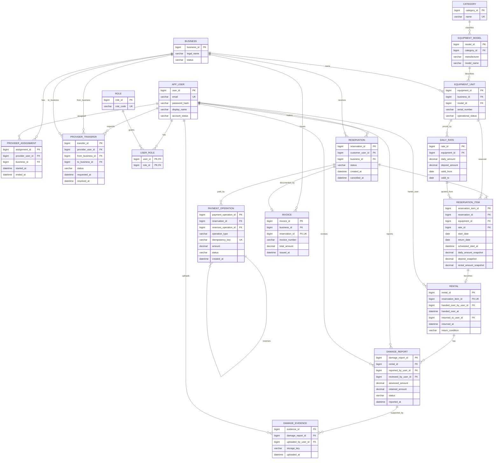

# Fase 2 — Modelo relacional y normalización

**Estado:** esquema y datos semilla preparados; pendientes de ejecutar y verificar en MySQL.

## 1. Alcance y supuestos de diseño

- Un negocio tiene proveedores, catálogo e inventario propios. Cada proveedor solo mantiene una asignación vigente; una transferencia queda pendiente y no cambia permisos hasta la aprobación.
- Un equipo reservable es una unidad física individual, no únicamente un modelo de herramienta.
- Una reserva puede agrupar una o varias unidades. En esta primera versión se cancela la reserva completa; no se contempla cancelar líneas parciales.
- Las fechas de renta son fechas calendario inclusivas (inicio y devolución incluidos); fines de semana y festivos cuentan. No se manejan fracciones de día.
- `scheduled_start_at` conserva la hora local acordada de inicio para aplicar el plazo de cancelación de 24 horas; la disponibilidad y el cobro diario siguen usando las fechas inclusivas.
- La tarifa y el depósito se guardan como una cotización acordada en la reserva. Cambios futuros de tarifa no alteran reservas existentes.
- Para cancelaciones antes de la entrega, el depósito se devuelve completo. El reembolso de renta es del 100% si faltan al menos 24 horas y del 90% si faltan menos de 24 horas.
- En daños, quien hizo la entrega adjunta evidencia y notifica a un superior. El superior resuelve la retención, limitada al depósito.
- Los pagos son simulados. La moneda propuesta es COP; puede cambiarse si la rúbrica indica otra.
- Identificadores técnicos son `BIGINT`; dinero usa `DECIMAL(12,2)`; instantes de auditoría se almacenan en UTC y los períodos de renta como fechas locales del negocio.

## 2. Diagrama entidad-relación

## 3. Modelo relacional propuesto

PK = clave primaria; FK = clave foránea; UK = restricción única.

1. `APP_USER(user_id PK, email UK, password_hash, display_name, account_status, created_at)`
2. `ROLE(role_id PK, role_code UK)`; `USER_ROLE(user_id PK/FK, role_id PK/FK)`.
3. `BUSINESS(business_id PK, legal_name, status, created_at)`.
4. `PROVIDER_ASSIGNMENT(assignment_id PK, provider_user_id FK, business_id FK, started_at, ended_at)`.
5. `PROVIDER_TRANSFER(transfer_id PK, provider_user_id FK, from_business_id FK, to_business_id FK, requested_at, status, resolved_at, resolved_by_user_id FK)`.
6. `CATEGORY(category_id PK, name UK)`.
7. `EQUIPMENT_MODEL(model_id PK, category_id FK, manufacturer, model_name, description)`.
8. `EQUIPMENT_UNIT(equipment_id PK, business_id FK, model_id FK, serial_number, operational_status, created_at, UNIQUE(business_id, serial_number))`.
9. `DAILY_RATE(rate_id PK, equipment_id FK, daily_amount, deposit_amount, currency, valid_from, valid_to)`.
10. `RESERVATION(reservation_id PK, customer_user_id FK, business_id FK, status, created_at, cancelled_at, cancellation_reason)`.
11. `RESERVATION_ITEM(reservation_item_id PK, reservation_id FK, equipment_id FK, rate_id FK, start_date, return_date, scheduled_start_at, daily_amount_snapshot, deposit_snapshot, rental_amount_snapshot)`.
12. `RENTAL(rental_id PK, reservation_item_id UK/FK, handed_over_by_user_id FK, handed_over_at, returned_to_user_id FK, returned_at, return_condition)`.
13. `DAMAGE_REPORT(damage_report_id PK, rental_id FK, reported_by_user_id FK, reviewed_by_user_id FK, reported_at, assessed_amount, retained_amount, status, decision_note)`.
14. `DAMAGE_EVIDENCE(evidence_id PK, damage_report_id FK, uploaded_by_user_id FK, storage_key, media_type, uploaded_at)`.
15. `PAYMENT_OPERATION(payment_operation_id PK, reservation_id FK, reverses_operation_id FK NULL, operation_type, idempotency_key UK, amount, currency, status, created_at)`.
16. `INVOICE(invoice_id PK, business_id FK, reservation_id UK/FK, invoice_number, total_amount, currency, issued_at, status, UNIQUE(business_id, invoice_number))`.

Los reportes se calculan desde estas fuentes de verdad; no se duplica su información en tablas transaccionales. La evidencia se conserva como referencia a almacenamiento (`storage_key`), no como bytes dentro de MySQL.

## 4. Normalización desde un diseño inicial

### Diseño inicial y anomalías

Una hoja de alquiler única podría repetir en cada fila los datos del negocio, cliente, equipo, categoría, proveedor y tarifa, además de guardar listas de pagos y fotos de daños en columnas tipo CSV. Esto permite anomalías: actualizar el correo de un cliente en muchas filas, no poder registrar un negocio sin alquiler, o borrar el único alquiler y perder datos del equipo. Las listas en una celda tampoco son atómicas.

### Primera forma normal (1FN)

Se eliminan listas CSV y grupos repetidos. Cada celda contiene un valor atómico: cada pago es una fila y cada evidencia una fila. Las claves identifican filas. Esto aún puede duplicar nombres y datos descriptivos en cada alquiler.

### Segunda forma normal (2FN)

En una hoja con clave compuesta `(reservation_id, equipment_id)`, atributos como `created_at`, `customer_user_id` y estado dependen solo de `reservation_id`; nombre de modelo y número de serie dependen solo de `equipment_id`. Se separan `RESERVATION`, `RESERVATION_ITEM` y `EQUIPMENT_UNIT`, evitando dependencias parciales respecto de una clave compuesta.

### Tercera forma normal (3FN)

Dependencias funcionales representativas:

- `user_id → email, password_hash, display_name, account_status`
- `business_id → legal_name, status`
- `category_id → name`
- `model_id → category_id, manufacturer, model_name, description`
- `equipment_id → business_id, model_id, serial_number, operational_status`
- `reservation_id → customer_user_id, business_id, status, created_at, cancelled_at`
- `reservation_item_id → reservation_id, equipment_id, rate_id, fechas, hora programada de inicio y cotización acordada`
- `payment_operation_id → reservation_id, tipo, clave de idempotencia, importe, estado, fecha`

Se separan categoría, modelo, unidad física, usuario y negocio. Así se evita que un atributo no clave determine otro atributo no clave dentro de la misma tabla. La tarifa acordada se conserva como instantánea en la línea de reserva; no se deriva de la tarifa vigente al consultar.

### Cuarta forma normal (4FN)

La 4FN atiende dependencias multivaluadas independientes. Los requisitos dados no establecen que una misma fila de negocio tenga dos conjuntos independientes que deban combinarse; por eso no se inventan tales dependencias para dividir tablas. Los hechos repetibles observables tienen dueño y dependencia claros: asignaciones pertenecen a proveedor/negocio, pagos a reserva, y evidencias a un reporte de daño. Se modelan en relaciones separadas (`PROVIDER_ASSIGNMENT`, `PAYMENT_OPERATION`, `DAMAGE_EVIDENCE`) y no como listas ni como producto cartesiano en una tabla de alquiler.

Cada relación propuesta representa un hecho o una asociación. No se identifican dependencias multivaluadas no triviales dentro de una de ellas bajo las reglas conocidas; por tanto, se considera que el esquema cumple 4FN. Si luego se agregan, por ejemplo, varios conjuntos independientes de atributos multivaluados, se revisará la 4FN usando reglas de negocio confirmadas antes de descomponer.

## 5. Restricciones, índices y concurrencia

- FK en todas las relaciones; `NOT NULL` en claves, estados y datos requeridos. Borrado lógico/estado para usuarios, negocios y equipos con historial.
- Email y código de rol únicos; número de serie único por negocio; número de factura único por negocio; clave de idempotencia única.
- Validar `return_date >= start_date`, montos no negativos, `valid_to > valid_from` y `retained_amount <= deposit_snapshot` en el caso de uso/transacción (MySQL no puede expresar fácilmente una restricción que compare columnas de tablas relacionadas).
- Índices en `EQUIPMENT_MODEL(model_name)`, `RESERVATION_ITEM(equipment_id, start_date, return_date)`, `RESERVATION(status, created_at)`, `EQUIPMENT_UNIT(business_id, operational_status)`, `PROVIDER_ASSIGNMENT(provider_user_id, ended_at)` y pagos por reserva/estado.
- MySQL no tiene una restricción de exclusión temporal para rangos. Para reservar, iniciar una transacción InnoDB, bloquear la fila de `EQUIPMENT_UNIT` (`SELECT ... FOR UPDATE`), comprobar intervalos solapados de reservas activas, insertar y confirmar. Todas las escrituras de reserva deben seguir el mismo protocolo. La fecha final inclusiva exige detectar solapamiento con `existing.start_date <= requested.return_date AND existing.return_date >= requested.start_date`.
- Para asignación vigente única de proveedor puede usarse una columna generada que sea `provider_user_id` cuando `ended_at IS NULL` y NULL en otro caso, con índice único; alternativamente separar asignación actual de historial. Se decidirá en la implementación según versión y claridad académica.

## 6. Validación antes de generar SQL

La decisión que más afecta la cardinalidad del modelo es si una reserva puede incluir varias unidades. La propuesta permite una o más unidades y cancela la reserva completa en la primera versión. Si luego prefieres una reserva por equipo, se puede simplificar `RESERVATION_ITEM` y la regla de cancelación.

El resto del modelo usa las reglas provisionales que acordamos: fechas inclusivas, COP, devolución completa del depósito al cancelar antes de la entrega, retención por daños aprobada por un superior hasta el límite del depósito y transferencia pendiente sin cambio de asignación actual.

Los archivos [001_schema.sql](../database/001_schema.sql), [002_seed_demo.sql](../database/002_seed_demo.sql) y [README.md](../database/README.md) contienen el DDL, los datos ficticios y las instrucciones de ejecución. Los seeds cubren 20 filas en las entidades principales cuando es razonable; daños/evidencias son opcionales y tienen cinco casos, mientras que las transferencias tienen dos ejemplos pendientes. Los registros de la inicialización en Docker confirman que ambos scripts se ejecutaron sin errores en MySQL 8.4.11.

La ejecución inicial del esquema y de los datos semilla está completada. La siguiente verificación será consultar los datos y conectar la aplicación Java al esquema existente. Si aparece un requisito nuevo, las reglas y el modelo pueden ajustarse.
